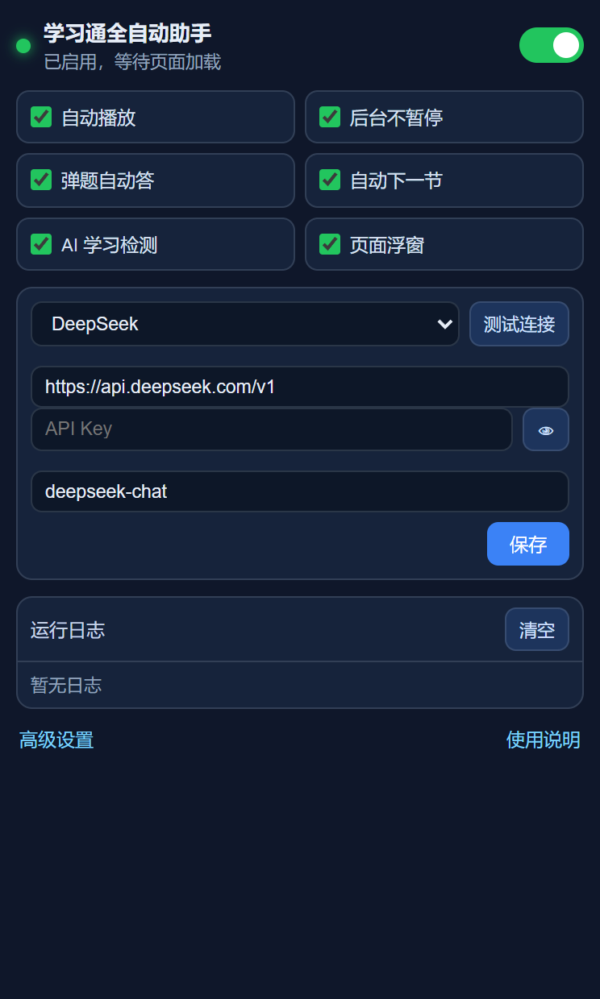

# 学习通全自动助手（浏览器扩展 · MV3）

一个跑在超星学习通 / 泛雅（`*.chaoxing.com`）页面上的原生浏览器扩展：自动播放、防暂停保活、视频弹题作答、学完自动下一节、学习检测 / 章节测验调用 AI 答题，附带字体加密还原与样本采集工具链。

由早期一份个人用的油猴脚本重写而来，现在是完整的扩展工程 + 零依赖本地测试台。

`v1.4.3` · GPL-3.0 · 73 项本地断言 · Edge / Chrome 111+

## 目录

- [这是什么](#这是什么)
- [功能一览](#功能一览)
- [安装](#安装)
- [日常使用](#日常使用)
  - [1. 第一次配置 AI](#1-第一次配置-ai)
  - [2. 开始一节课](#2-开始一节课)
  - [3. 浮窗上的每个按钮](#3-浮窗上的每个按钮)
  - [4. 常用设置](#4-常用设置)
  - [5. 暂停 / 恢复 / 换课](#5-暂停--恢复--换课)
  - [6. 到课程末尾](#6-到课程末尾)
  - [7. 什么时候需要你亲自看一眼](#7-什么时候需要你亲自看一眼)
- [调试](#调试)
  - [1. 先看日志](#1-先看日志)
  - [2. 诊断按钮](#2-诊断按钮)
  - [3. 本地命令桥](#3-本地命令桥)
  - [4. 字体样本采集器](#4-字体样本采集器)
  - [5. 本地测试台](#5-本地测试台)
  - [6. 排查表](#6-排查表)
  - [7. 调试时的隐私注意](#7-调试时的隐私注意)
- [工作流程](#工作流程)
- [字体还原原理](#字体还原原理)
- [目录结构](#目录结构)
- [预览](#预览)
- [已知边界](#已知边界)
- [版本](#版本)
- [许可](#许可)
- [免责声明](#免责声明)

## 这是什么

- 一个 **Manifest V3** 浏览器扩展，只注入 `*.chaoxing.com`。
- 做四件事：把视频放完 → 弹题答对 → 测验做过 → 自动切下一章。
- 答题能力不内置题库，全部走**你自己配置的** OpenAI 兼容接口（也可以接本地 Ollama，内容不出本机）。
- 附带一套零依赖本地测试台（仿真页面 + Mock AI），不需要账号就能验证大部分逻辑。

## 功能一览

| 能力 | 实现位置 | 说明 |
|---|---|---|
| 伪造 `document.hidden / visibilityState` | `extension/content/antipause-main.js` | 注入 **MAIN world**；隔离世界改原型对页面自身脚本无效 |
| 拦 `window/document` 上的 `mouseout` 暂停 | `extension/content/antipause-main.js` | 只拦 mouseout，不误伤 blur / visibilitychange |
| 丢弃 `videojs_id` cookie（多开互斥） | `extension/content/antipause-main.js` | 改写 `Document.prototype.cookie` 只在主世界有效 |
| 视频自动播放（`volume=0` 而非 muted） | `extension/content/player.js` | 内核在页面隐藏时只暂停「一直静音」的视频，音量 0 可绕过 |
| 无音轨视频 `captureStream` 保活镜像 | `extension/content/player.js` | 后台 / 最小化不被内核暂停 |
| 暂停即续播看门狗 + 站点 `resumePlay` 通道 | `extension/content/player.js` | 三层兜底 |
| 视频内弹题自动作答（判断 / 单选 / 多选） | `extension/content/videoquiz.js` | 先问 AI，失败退回组合枚举 |
| 答对后自动点「继续学习」并恢复播放 | `extension/content/videoquiz.js` | — |
| 学习检测 / 章节测验 AI 答题 | `extension/content/exam.js` | 解析 → 填答 → 提交 → 判分 → 只重做「判错 + 半对」 |
| 判分归属校验 | `extension/content/exam.js` | 判分页没更新到本轮就整轮作废，不会拿上一轮的勾叉改答案 |
| 半对按组合试探 | `extension/content/exam.js` | `AC → ABC → ACD → ABCD`，每轮只加一个选项 |
| 学完自动下一节 | `extension/content/nav.js` | 带跳转仲裁，避免多 iframe 同点跳两节 |
| 已完成 / 空页面自动跳过 | `extension/content/nav.js` | 无待办任务点、无题目 → 直接下一节 |
| 课程末尾自动停止 | `extension/content/nav.js` | 没有下一章且无「下一节」按钮持续 12 秒 → 判定末尾并停 |
| 轮数用尽跳下一章 | `extension/content/exam.js` + `nav.js` | 可关；开后不再卡死在同一节 |
| 任务点完成判定 | `extension/content/player.js` | aria-label + `.task-condition` + `ended` 事件 |
| 加密字体还原（选择题乱码） | `extension/content/ttf.js`、`glyphmatch.js`、`fontdecrypt.js` | 字形表 + 逆查，自带字典 `extension/data/` |
| 字体样本采集器 | `extension/content/fontsampler.js` | 页面右上角浮窗，样本落扩展本地存储 |
| 页面浮窗 | `extension/content/hud.js` | 状态 / 日志 / 暂停 / 设置入口，可拖动 |
| 完整设置页 + 弹窗 | `extension/options.*`、`extension/popup.*` | 字段级保存，导入导出，AI 连接测试 |
| 页面范围判定 | `extension/content/common.js` | `CX.pageKind` / `CX.isStudyContext()`：非学习页不挂浮窗、不跑自动化 |

## 安装

### 方式 A：下载 Release 压缩包（推荐）

1. 到本仓库的 **Releases** 页面下载 `chaoxing-helper-v1.4.3.zip`，解压。
2. 浏览器地址栏打开 `edge://extensions`（Chrome：`chrome://extensions`），开启右上角「开发人员模式」。
3. 点「加载解压缩的扩展」，选择解压出来的文件夹（有 `manifest.json` 的那一层）。
4. 点扩展图标 →「高级设置」→「AI 接口」→ 填 Base URL / API Key / 模型名 → 「测试 AI 连接」。

### 方式 B：直接从源码加载

```bash
git clone <this-repo> chaoxing-helper
```

然后同上，第 3 步选仓库里的 `extension/` 目录。

> 更新版本时：把新压缩包解压**覆盖**原文件夹，再到 `edge://extensions` 点一次「重新加载」，最后刷新学习页（旧标签是孤儿脚本）。

## 日常使用

### 1. 第一次配置 AI

接口按 OpenAI 兼容格式调用：`POST {baseUrl}/chat/completions`。

| 服务商 | Base URL | 模型示例 |
|---|---|---|
| DeepSeek | `https://api.deepseek.com/v1` | `deepseek-chat` |
| OpenAI | `https://api.openai.com/v1` | `gpt-4o-mini` |
| 通义千问 | `https://dashscope.aliyuncs.com/compatible-mode/v1` | `qwen-plus` |
| Kimi | `https://api.moonshot.cn/v1` | `moonshot-v1-8k` |
| 智谱 GLM | `https://open.bigmodel.cn/api/paas/v4` | `glm-4-flash` |
| 本地 Ollama | `http://127.0.0.1:11434/v1` | `qwen2.5:7b` |

步骤：

1. 点扩展图标 →「高级设置」→ 找到「AI 接口」卡片；
2. 选服务商（或直接填 Base URL）、填 API Key、选模型（「拉取」会按你填的地址列出该 Key 可用的模型）；
3. 点页面顶部「测试 AI 连接」，出现绿色通过即可 —— 设置是**即时保存**的，没有“保存”按钮；
4. 接口不支持 `response_format` 时，把「使用 JSON 模式」关掉；
5. 用 `127.0.0.1` / `localhost` 的本地模型可以不填 Key。

### 2. 开始一节课

1. 打开任意课程章节页（`mooc1.chaoxing.com/mycourse/studentstudy?...`）；
2. 页面右下角出现浮窗，标题旁显示「**运行中**」；
3. 之后你不需要做任何事，它按这个顺序自己走：

```
未完成的视频 → 自动开播（音量 0） → 保活
      ├─ 弹题出现 → AI 作答 → 答对 → 点「继续学习」→ 恢复播放
      └─ 任务点完成 → 有「学习测验」就进去做 → 判分 → 只重做判错/半对的题
                          └─ 任务点变成「已完成」→ 切下一章
```

4. 一节课跑完会自动进下一节，直到课程末尾自动停止。

### 3. 浮窗上的每个按钮

| 按钮 | 作用 | 什么时候用 |
|---|---|---|
| **运行中 / 已暂停** | 当前状态；点一下在“暂停全部自动化 / 继续”之间切换 | 想临时接管、手动答题时 |
| **高级设置** | 打开设置页 | 改 AI、改阈值 |
| **诊断** | 把当前帧的结构探针 JSON 打到日志里 | 页面结构对不上、要报 issue 时 |
| **重载扩展** | 重载扩展后自动刷新本页 | 更新代码后（等价于 `edge://extensions` 的重新加载 + F5） |
| **重载配置** | 只重读配置，不换代码 | 改了设置但页面没跟上 |
| **清日志** | 清空日志环 | 复现问题前先清一遍 |
| **收起** | 折叠日志区，只留状态行 | 平时不占地方 |

> 浮窗可以按住标题栏拖动；每个 frame 都有自己的状态，**顶层那个浮窗**才是总状态。

### 4. 常用设置

设置页顶部有搜索框，直接搜「轮数」「倍速」就能定位。日常只用这几个：

| 设置 | 默认 | 说明 |
|---|---|---|
| 启用全自动（总开关） | 开 | 只管播放 / 弹题 / 答题 / 跳章 |
| 防暂停 / 后台播放 | 开 | 改完要刷新页面才生效（页面加载时被吞掉的监听救不回来） |
| 弹题自动作答 | 开 | 视频内弹题 |
| 学完自动下一节 | 开 | 关掉则停在原地 |
| AI 学习检测 | 开 | 章节测验 / 学习检测自动答题 |
| **轮数用尽就跳下一章** | **开** | 跑满「最多提交轮数」仍没过 → 放弃本节测验并切下一章，不卡死 |
| 最多提交轮数 | 3 | 每轮“任务点仍未完成”才重做；别调大，站点经不起高频提交 |
| 倍速 | 1× | 调高有被判异常的风险，自己权衡 |
| 页面浮窗 | 开 | 关掉后只能从弹窗看状态 |

### 5. 暂停 / 恢复 / 换课

- **暂停**：点浮窗「运行中」，或弹窗里的总开关；
- **恢复**：再点一次；恢复后会自动清掉暂停状态，不用刷新；
- **换课**：直接打开别的章节页即可，扩展会按当前页面重新开始；同一门课的历史作答记忆按卷子 id 隔离，不会串。

### 6. 到课程末尾

到最后一节时：

- 页面没有下一章、也没有可用的「下一节」按钮；
- 扩展等 `nav.endConfirmMs`（默认 12 秒，确认不是目录还没渲染）后判定结束；
- 浮窗状态变「🎉 课程已到末尾，自动停止」，日志写一条「连续 N 秒找不到下一章 → 判定课程结束」；
- 如果你不想到末尾停，把「课程末尾自动停止」关掉即可。

### 7. 什么时候需要你亲自看一眼

| 现象 | 原因 |
|---|---|
| 浮窗提示「⚠ 未配置 AI Key」 | 没填 Key 或 Base URL 不对，自动答题会跳过 |
| 站点弹出验证码 / 提交次数上限 | 提交太频繁，扩展会刹车，需要你手动处理 |
| 「今日视频任务点已达上限」 | 平台限制，能播但不计进度，只能等次日 |
| 正式考试页 | 默认不碰（设置里可开，风险自担） |
| 浮窗「点目录后章节 id 没变」连刷三次 | 章节还没解锁 / 站点没响应，扩展会停止重试

## 调试

### 1. 先看日志

两层日志：

- **浮窗日志**：右下角浮窗里最近几条（点「收起」折叠）；
- **完整日志**：设置页最下面「调试」→ 需要先打开「调试模式」，然后能看到「实时日志」（最近 200 条，可复制）。

日志级别：

| 级别 | 何时用 |
|---|---|
| `error` / `warn` | 只想看问题 |
| `info`（默认） | 日常足够：作答轮次、判分结果、切章决策 |
| `debug` | 排查结构/时序问题：会打印结构探针、判分原文、重试候选 |

**报 issue 的正确姿势**：清日志 → 复现一次 → 复制日志（含时间戳）。`debug` 级别会包含题目文本，贴之前自己扫一眼。

### 2. 诊断按钮

浮窗「诊断」会把当前帧的结构探针写成一段 JSON 进日志，包含：

- 容器命中数（`.questionLi` / `.TiMu` / `.ans-job-video` …）、输入框数量、提交按钮、body 前三行；
- 任务点、任务条文案、目录条目、`#prevNextFocusNext` 的 outerHTML；
- 当前视频状态、判分图标 class、字体 face 信息。

页面改版导致“找不到题目/点不动”时，这段 JSON 就是加选择器的依据。

### 3. 本地命令桥

用于本机排查：让扩展每 1.2 秒向一个本地 HTTP 服务取命令，把日志/探针回传。

1. 设置页 →「调试模式」打开 →「本地命令桥」打开；
2. 「命令桥地址」填 `http://127.0.0.1:8765`（**默认是空的，等于完全不轮询**）；
3. 本机起服务：`node tools/_cmd-bridge.mjs`；
4. 用 curl 发命令，例如：

```bash
curl "http://127.0.0.1:8765/ping"
curl "http://127.0.0.1:8765/run?cmd=logs&arg=200"
curl "http://127.0.0.1:8765/run?cmd=stats&tabId=<标签页 id>"
curl "http://127.0.0.1:8765/run?cmd=tabs"
```

可用命令：

| 命令 | 作用 | 是否只读 |
|---|---|---|
| `logs [n]` | 后台日志环 | ✅ |
| `tabs` | 列出标签页 | ✅ |
| `stats [tabId]` | 各帧的字体/字形表状态 | ✅ |
| `q [tabId]` | 题目原文 vs 解码后文本 | ✅ |
| `raw` / `fonts` | 加密文本 / `@font-face` 摘要 | ✅ |
| `coldtest` | 逐字对比「字典 vs 逆查」 | ✅ |
| `setdict` / `getdict` | 读写字形字典 | ⚠️ 写 |
| `open` | 打开一个 URL | ⚠️ 写 |
| `resetexam` | 清掉本次测验的作答记忆（轮数用尽/脏历史时用） | ⚠️ 写 |

> 桥**没有认证**、还带 `access-control-allow-origin: *`，只在你自己机器上开、用完就关掉开关。

### 4. 字体样本采集器

站点把题目字体做了混淆（`.font-cxsecret`）。扩展自带字典能还原大部分；遇到认不出的字，可以自己采样本喂给字典：

1. 打开「调试模式」→ 右侧出现「字体样本采集器」浮窗；
2. 本机起收样服务：`node tools/sample-server.mjs`（默认 `127.0.0.1:8788`）；
3. 在学习页上点采集 → 样本落到 `_samples/`；
4. 汇总成字典：`node tools/aggregate-samples.mjs`，或在收样面板点「汇总」；
5. 字典也可以直接看状态：桥命令 `stats` / `coldtest`。

### 5. 本地测试台

不需要账号，仿真页面 + Mock AI 覆盖绝大部分逻辑。

```bash
# 1) 起仿真服务 + Mock AI（8799）
node tools/mock-server.mjs 8799

# 2) 生成测试版扩展（把匹配域放宽到 127.0.0.1）
node tools/make-test-build.mjs

# 3) 真 Edge + 真扩展跑端到端
node tools/run-test.mjs all
```

单场景：

```bash
node tools/run-test.mjs ui|hud|antipause|exam|exam-li|video-quiz|nav|quiz-entry|guard|done|review|toc|toc-child|empty|empty-optin|empty-guard|font|retry|giveup|end
```

当前状态：`all` = **73 项断言全过**。

| 场景 | 覆盖什么 |
|---|---|
| `exam` / `exam-li` | 两种题目 DOM：作答 → 未通过 → 只重做错题 → 通过 |
| `retry` | 半对组合试探：`AC → ABC → ACD → ABCD`、判断题翻转 |
| `font` | 字形字典加载（`data/` 可取、表非全零）、无字体时早退 |
| `giveup` | 轮数用尽 → 放弃本节 |
| `end` | 最后一节（无下一章、无按钮）→ 自动停止 |
| `antipause` / `hud` / `ui` | 主世界防暂停、浮窗、设置页 |

依赖：**Node ≥ 22**（用到内建 `WebSocket` 与 `fetch`）、**Windows + Edge**（脚本里的浏览器路径只写了 `msedge.exe`，用 Chrome 或 macOS/Linux 需自己改 `EDGE` 常量）。测试产物 `_test-build/`、`_test-profile/` 已忽略。

对比不同构建：`RUN_TEST_BUILD=<dir> node tools/run-test.mjs font`。

### 6. 排查表

| 症状 | 先看什么 | 常见原因 / 处理 |
|---|---|---|
| 视频不自动播 | 浮窗状态 + 日志 | 浏览器要求用户手势 → 在页面点一下；或「自动播放」被关 |
| 切后台就暂停 | 日志有「保活」吗 | 关掉浏览器「睡眠标签页 / 效率模式」（`edge://settings/system`） |
| 不切下一章 | 「目录里没找到下一项」「章节 id 没变」 | 章节未解锁 / 目录没展开；扩展会在 12 秒后重试，连续 3 次失败会停 |
| 测验一直不过 | 日志「本轮判分」「本轮只改 N 题」 | 看「判分页没更新到本轮作答」是否出现；出现说明站点批分慢，扩展会作废该轮 |
| 到末尾不停 | 日志有没有「等 N 秒确认是否到课程末尾」 | 没有 → 页面里其实还有目录项；有 → 看是否被 12 秒宽限挡住 |
| 题目是乱码 | 桥 `stats` / `q` | 字形表没就绪（看 `src`/`nz`）或字典缺字，用采集器补样本 |
| 浮窗不出现 | 是否在 `*.chaoxing.com` 页面 | 其他域名不注入；刷新一次 |
| 命令桥没反应 | `curl .../ping` | 桥没起 / 开关没开 / 地址没填 |
| 设置改了没生效 | 是否需要刷新 | 「防暂停」类改动必须 F5；其余即时生效 |

### 7. 调试时的隐私注意

- 日志会包含题目文本、章节名，`debug` 级别还会打印判分原文 —— 贴出去前先自己过一遍；
- 导出的配置文件里 API Key 是 `***`，但**日志/截图**可能带 Key 以外的信息，注意别把整页截图发出去；
- 命令桥开着时，本机任何进程都能驱动扩展，用完就关。

## 工作流程

```
进入学习页
   ├─ 有未完成视频 → 自动开播（音量 0） → 看门狗保活
   │     ├─ 弹题出现 → AI / 枚举作答 → 答对 → 点「继续学习」→ 恢复播放
   │     └─ 任务点标记完成 → 任务条有「学习测验」就先做测验
   ├─ 切章节：优先点右侧目录里的下一章（.posCatalog_name），
   │         目录不可用才回退「下一节」按钮；两者都没有 12 秒 → 判定课程末尾
   ├─ 题目页（学习检测 / 章节测验 / 作业）
   │     ├─ 判分 → 只重做「判错 + 半对」，判对的题保持原答案
   │     ├─ 半对：每轮只加一个选项（AC → ABC → ACD → ABCD）
   │     └─ 任务点完成 → 直接切下一节；轮数用尽且开关打开 → 放弃本节、切下一章
   └─ 已批阅页 → 只读任务点 / 成绩状态，不再答题
```

跳转仲裁：所有 frame 都向后台申请「点击权」，2.5 秒内只放行一个。

## 字体还原原理

站点的做法：把真字换成另一批码位（密文），再用 `@font-face` 把那些码位**画成正确字形**。
所以页面上看到的是“乱码”，截屏/复制出来也是乱码 —— 但字形本身是对的。扩展就从字形反推真字：

1. **取字体**：扫描页面里的 `@font-face`，把内嵌字体（data URL）取出来，`content/ttf.js` 解析 cmap / glyf；
2. **算指纹**：对每个待还原的码位取出字形轮廓，归一化后光栅化成 32×32 的位图，连同宽高、基线一起当成这个字形的「指纹」；
3. **查字典**：先查随扩展分发的 `extension/data/glyphdesc.bin.gz`（20945 个常用汉字的指纹，由开源字体 Source Han Sans 离线生成）；
4. **逆查（近似匹配）**：字典没覆盖的字，拿页面字形的指纹去和**整张表**逐行比对（容差 `tol=0.35`），最接近的那个就是候选；
5. **写回字典**：逆查认出来的字按指纹记进 `cxGlyphDict`（存在本机），同一份字体下次直接命中，不用再比；
6. **升序校验**：站点生成器按真字码位升序分配 gid，所以把已解出的字按 gid 排序后，码位必须单调递增；出现逆序说明有认错的，会自动纠正或丢弃那一条。

自检方式：

- 日志：`字形逆查表就绪：20945 字（来源 fetch，nz=65491）` —— `nz` 是表前 64 KB 的非零字节数，**接近 6 万才算表正常**；如果 `nz=0`，说明拿到的是空表；
- 字体还原日志：`字体还原：字典 19 + 逆查 0 + 校验修 0/弃 0 / 共 19` —— 「字典」是查表命中，「逆查」是近似匹配命中；
- 桥命令：`stats`（各帧字典/表状态）、`q`（题目原文 vs 解码后）、`coldtest`（逐字对比字典与逆查结果）。

已知限制：近似匹配对笔画密度接近的字（力/为、合/台）可能认错；页面上出现新字体时，第一轮要先建表（约 0.1~0.4 秒）；表只在出现 `.font-cxsecret` 的帧里加载，每帧约 21 MB 内存。
## 目录结构

```
extension/
  manifest.json           MV3 清单（content_scripts 全 frame 注入）
  background.js           AI 代理、日志/状态广播、跳转仲裁、答案缓存
  shared/config.js        默认配置 + 服务商预设 + 深合并
  shared/glyphdict.js     字形字典读取
  content/
    antipause-main.js     主世界防暂停（伪造可见性 / 拦 mouseout / 丢 videojs_id）
    common.js             配置热更新、日志、DOM 工具、消息封装
    ttf.js                TrueType 解析
    glyphmatch.js         字形指纹比对（含表完整性自检）
    fontdecrypt.js        加密字体还原
    parser.js             题目解析（多种题库 DOM）+ 结构探针
    hud.js                页面浮窗
    probe.js              结构探针（调试模式才铺 DOM）
    player.js             自动播放 / 保活 / 完成判定
    videoquiz.js          弹题作答 + 继续学习
    exam.js               测验作答 / 判分归属校验 / 重做策略
    nav.js                页面类型判定 + 切章 + 末尾判定
    fontsampler.js        字体样本采集器
  data/                   字形字典（glyphdesc.bin.gz / glyphmeta.json）
  popup.html/js/css       快捷面板
  options.html/js/css     完整设置
  help.html               内置使用说明
tools/
  mock-server.mjs         仿真页面 + Mock OpenAI 接口
  make-test-build.mjs     生成测试版扩展
  run-test.mjs            CDP 端到端测试
  sample-server.mjs       字体样本收样服务
  aggregate-samples.mjs   样本汇总成字形字典
  _cmd-bridge.mjs         调试用本机命令桥（默认关闭）
  probe-sw.mjs            探查扩展 service worker
test/
  fixtures/               仿真页面（exam / video-quiz / nav / knowledge / font-quiz）
  screenshots/            界面截图
docs/images/              README 用图
```

## 预览

> 图在下面，点开可看原图。

**设置页**（全部参数，按主题折叠；顶部搜索框可直接搜「轮数」「倍速」）


**弹窗**（常用开关 + 当前状态 + AI 快捷配置）



## 已知边界

- **非学习页不再挂浮窗、也不跑自动化**（`v1.4.3`）：个人空间（`i.chaoxing.com`）、消息、登录页上 `CX.isStudyContext()` 为 `false`，浮窗不创建、导航/播放/答题都不启动；学习页即使换路径，也会用 DOM 特征（任务条、目录、题目容器、`video`）兜底判定。此前“个人空间里误报课程已到末尾”的现象因此不会再出现。- **通过判定只看任务点**：提交后不看分数、不看及格线，只看任务条上「学习测验」有没有变成「已完成」。
- **防暂停必须跑在主世界**：这也是老油猴脚本 `@grant none` 能生效、而普通 content script 失效的原因。
- **判分有延迟**：站点提交后原地重绘，旧勾叉会先留在 DOM。扩展会比对「我的答案」与本轮提交内容，对不上就继续等；超过 10 秒仍对不上则**整轮作废**（不会拿旧数据改答案）。
- **多选只能试探**：判分只给“对/半对/错”，正确选项组合靠半对集合逐次补一个来逼近（`AC → ABC → ACD → ABCD`）；四选多选最多 3 轮。
- **浏览器会降频后台标签页**：插件已用音量 0 + 伪造可见性保活，但「睡眠标签页 / 效率模式」只能自己在 `edge://settings/system` 关掉或加白名单。
- **不自动处理「笔记未保存」弹窗**：点它反而会卡住导航。
- **页面结构变更**：解析器对常见结构都做了兜底；真遇到不认识的页面，把日志级别调成 `debug`，日志里的「结构探针」会给出容器命中数、输入框数量、提交按钮、body 长度。
- **正式考试默认不自动作答**（设置里可开）。

## 版本

当前 `1.4.3`。改动见 [CHANGELOG.md](CHANGELOG.md)。

## 许可

- 代码：[GPL-3.0](LICENSE)（copyleft：修改或衍生后分发，必须以同样的 GPL-3.0 协议开源，不能闭源商业发布）
- 内置字形字典由思源黑体（Source Han Sans，SIL OFL-1.1）生成，来源与许可见 [docs/FONT-NOTICE.md](docs/FONT-NOTICE.md)

## 免责声明

**零、授权与使用约定**

- 本项目代码遵循 [GPL-3.0 License](LICENSE)：允许开源 / 免费使用、引用、修改、衍生；修改或衍生的代码**必须以同样的 GPL-3.0 协议开源**，不允许作为闭源的商业软件发布和销售。
- 本项目仅用于学习与讨论，禁止用于盈利。
- 他人或组织使用本代码进行的任何行为，与作者无关。

**一、项目性质**

- 本项目是浏览器前端自动化技术的示例实现，面向个人学习与技术研究；它不是商品，也不是服务，不提供代刷、代考、题库或任何答案数据。
- 代码中所有「答题」能力都必须由使用者自行配置第三方 AI 接口；仓库本身不携带任何题目、答案或课程内容。

**二、使用范围与责任**

- 仅限在你本人有权访问的账号与课程页面上使用；不得用于他人账号、付费代办或商业转售。
- 是否允许使用自动化工具、使用后产生什么结果，由你自行判断并承担。请自行确认所在学校/单位的规定与超星平台的用户协议。
- 因使用或无法使用本项目而产生的任何直接或间接后果——包括但不限于任务点异常、成绩或进度变化、账号被限制或封禁、数据丢失、设备或网络故障——作者不承担任何责任。

**三、数据处理**

- 扩展只在本机浏览器内运行，**不含任何统计、遥测或上报代码**，可自行审查 `extension/` 下全部源码。
- 你填写的 API Key 只保存在本机 `chrome.storage.local`；导出配置时 Key 会被替换成 `***`，不会随文件外泄。
- 题目文本只会发送到**你自己配置的** AI 接口。使用云端服务商时请自行阅读其隐私条款；想让内容完全不出本机，请使用本地模型（如 Ollama）。

**四、第三方组件与权利**

- 内置字形字典由开源字体 Source Han Sans（SIL OFL-1.1）生成，来源与许可见 [docs/FONT-NOTICE.md](docs/FONT-NOTICE.md)；字典中不含任何课程或平台数据。
- 仓库不包含任何平台字体文件、题库或课程素材。

**五、无担保**

- 本项目按「现状」提供，不附带任何明示或暗示的担保，包括但不限于适销性与特定用途适用性。
- 平台页面结构随时可能变化，作者不承诺任何版本持续可用，也不对因页面改版、接口变更导致的功能失效负责。

**六、费用**

- 使用第三方 AI 接口产生的费用由使用者自行承担。

**七、其他**

- 若你不同意上述任一条款，请停止使用并删除本项目文件。
- 本声明可能随版本更新调整，以仓库最新提交的版本为准。
