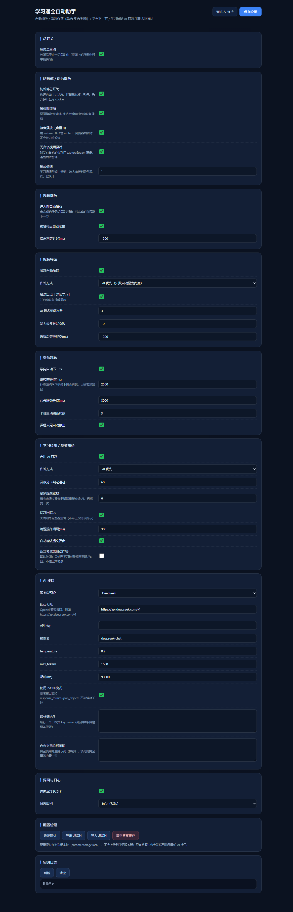

# 学习通全自动助手（浏览器扩展 · MV3）

一个跑在超星学习通 / 泛雅（`*.chaoxing.com`）页面上的原生浏览器扩展：自动播放、防暂停保活、视频弹题作答、学完自动下一节、学习检测 / 章节测验调用 AI 答题并按任务点判定重做，附带字体加密还原与样本采集工具链。

由早期一份个人用的油猴脚本重写而来，现在是完整的扩展工程 + 零依赖本地测试台。



## 功能

| 能力 | 实现位置 | 说明 |
|---|---|---|
| 伪造 `document.hidden / visibilityState` | `extension/content/antipause-main.js` | 注入 **MAIN world**；隔离世界改原型对页面自身脚本无效 |
| 拦 `window/document` 上的 `mouseout` 暂停 | `extension/content/antipause-main.js` | 只拦 mouseout，不误伤 blur / visibilitychange |
| 丢弃 `videojs_id` cookie（多开互斥） | `extension/content/antipause-main.js` | 改写 `Document.prototype.cookie` 只在主世界有效 |
| 视频自动播放（`volume=0` 而非 muted） | `extension/content/player.js` | 内核在页面隐藏时只暂停「一直静音」的视频，音量 0 可绕过 |
| 无音轨视频 `captureStream` 保活镜像 | `extension/content/player.js` | 后台 / 最小化不被内核暂停 |
| 暂停即续播看门狗 + 站点 `resumePlay` 通道 | `extension/content/player.js` | 三层兜底 |
| 视频内弹题自动作答（判断 / 单选 / 多选） | `extension/content/videoquiz.js` | 先问 AI，失败退回组合枚举 |
| 答对后自动点「继续学习」并恢复播放 | `extension/content/videoquiz.js` | — |
| 学完自动下一节 | `extension/content/nav.js` | 带跳转仲裁，避免多 iframe 同点跳两节 |
| 已完成 / 空页面自动跳过 | `extension/content/nav.js` | 无待办任务点、无题目 → 直接下一节 |
| 任务点完成判定 | `extension/content/player.js` | aria-label + `.task-condition` + `ended` 事件 |
| 学习检测 / 章节测验 AI 答题 | `extension/content/exam.js` | 批量解析 → 填答 → 提交 → 确认弹窗 → 按任务点重做 |
| 加密字体还原（选择题乱码） | `extension/content/ttf.js`、`glyphmatch.js`、`fontdecrypt.js` | 字形表 + 逆查，自带字典 `extension/data/` |
| 字体样本采集器 | `extension/content/fontsampler.js` | 页面右上角浮窗，样本落扩展本地存储 |
| 页面浮窗 | `extension/content/hud.js` | 阶段 / 日志 / 暂停 / 设置入口，可拖动 |
| 完整设置页 + 弹窗 | `extension/options.*`、`extension/popup.*` | 字段级保存，导入导出，AI 连接测试 |

## 安装

### 方式 A：下载 Release 压缩包（推荐）

1. 到本仓库的 **Releases** 页面下载 `学习通全自动助手-v1.4.2.zip`，解压。
2. 浏览器地址栏打开 `edge://extensions`（Chrome：`chrome://extensions`），开启右上角「开发人员模式」。
3. 点「加载解压缩的扩展」，选择解压出来的文件夹（有 `manifest.json` 的那一层）。
4. 点扩展图标 →「高级设置」→「AI 接口」→ 填 Base URL / API Key / 模型名 → 「测试 AI 连接」。

### 方式 B：直接从源码加载

```bash
git clone <this-repo> chaoxing-helper
```

然后同上，第 3 步选仓库里的 `extension/` 目录。

## AI 配置

接口按 OpenAI 兼容格式调用：`POST {baseUrl}/chat/completions`。

| 服务商 | Base URL | 模型示例 |
|---|---|---|
| DeepSeek | `https://api.deepseek.com/v1` | `deepseek-chat` |
| OpenAI | `https://api.openai.com/v1` | `gpt-4o-mini` |
| 通义千问 | `https://dashscope.aliyuncs.com/compatible-mode/v1` | `qwen-plus` |
| Kimi | `https://api.moonshot.cn/v1` | `moonshot-v1-8k` |
| 智谱 GLM | `https://open.bigmodel.cn/api/paas/v4` | `glm-4-flash` |
| 本地 Ollama | `http://127.0.0.1:11434/v1` | `qwen2.5:7b` |

- 接口不支持 `response_format` 时，把设置里的「使用 JSON 模式」关掉。
- API Key 只存在本机 `chrome.storage.local`，不进代码、不进仓库；题目内容只发送到你配置的接口。
- `127.0.0.1` / `localhost` 的本地模型可以不填 Key。

## 工作流程

```
进入学习页
   ├─ 有未完成视频 → 自动开播（音量 0） → 看门狗保活
   │     ├─ 弹题出现 → AI / 枚举作答 → 答对 → 点「继续学习」→ 恢复播放
   │     └─ 任务点标记完成 → 先看任务条有没有「学习测验」
   │            ├─ 有 → 点测验入口 → AI 做题 → 提交 →（确认弹窗再点提交）
   │            │      → 任务点变成「已完成」→ 通知导航（判定只看任务点，不看分数）
   │            └─ 无 → 直接切下一章
   ├─ 切章节：优先点右侧目录里的下一章（.posCatalog_name），
   │         目录不可用才回退到「下一节」按钮
   ├─ 题目页（学习检测 / 章节测验 / 作业）
   │     ├─ 选项可能是 input，也可能是 li（新版，class 选中）——两种都支持
   │     ├─ 任务点变成「已完成」→ 直接切下一节
   │     └─ 仍未完成 → 错题回喂 AI → 重做 → 再提交（最多 maxRounds 轮）
   └─ 已批阅页 → 只读任务点 / 成绩状态，不再答题
```

跳转仲裁：所有 frame 都向后台申请「点击权」，2.5 秒内只放行一个。

## 本地测试（不需要账号）

仿真页面复刻了超星的关键 DOM（`.ans-videoquiz`、`.questionLi/.Zy_TItle/.Zy_ulTop`、`.TiMu/.answerList`、`.completeBtn`、确认弹窗、`#prevNextFocusNext`），Mock AI 故意先答错、再答对，用来验证重试链路。

```bash
# 1) 起仿真服务 + Mock AI（8799）
node tools/mock-server.mjs 8799

# 2) 生成测试版扩展（只把匹配域名放宽到 127.0.0.1）
node tools/make-test-build.mjs

# 3) 真 Chrome / Edge + 真扩展跑端到端
node tools/run-test.mjs all
```

单场景：

```bash
node tools/run-test.mjs ui|hud|antipause|exam|exam-li|video-quiz|nav|quiz-entry|guard|done|review|toc|toc-child|empty|empty-optin|empty-guard|font
```

当前状态：`all` = **70 项断言全过**（headless Edge，真实加载扩展，断言读页面真实状态）。其中 `font` 场景确认两件事：字形字典 `data/` 能加载且表内容非全零（`src=fetch`、`nz>1000`），以及拿不到字体时 `fontdecrypt` 会早退、不硬跑一轮。

覆盖到的：

- 弹题识别为多选 → 首答错误 → 带反馈重问 → 答对 → 点「继续学习」；
- 6 道题（含第二种 DOM 结构）批量作答 → 首轮未通过 → 错题回喂 → 重做 → 通过；
- 空页面自动点「下一节」且不重复连点、同章只点一次测验入口；
- 设置页 40+ 配置项正常渲染、无 JS 异常。

依赖：**Node ≥ 22**（用到内建 `WebSocket` 与 `fetch`；Node 20 没有全局 `WebSocket`），**Windows + 本机装了 Edge**（`run-test.mjs`、`probe-sw.mjs` 里的浏览器路径只写了 `msedge.exe`；用 Chrome 或 macOS / Linux 需要自己改 `EDGE` 常量）。测试用的临时目录 `_test-build/`、`_test-profile/` 已在 `.gitignore` 里。

### 字体样本工具

```bash
# 收样服务（扩展里的「字体样本采集器」上传到这里）
node tools/sample-server.mjs
```

收样服务把所有样本落在 `_samples/`，点面板上的「汇总」会调用 `tools/aggregate-samples.mjs` 炼出 `glyphdict.json`（字形指纹 → 真字），扩展侧也能在本地重算同构字典。

`tools/probe-sw.mjs` 用于探查扩展 service worker；`tools/_cmd-bridge.mjs` 是设置页「调试 → 本地命令桥」对应的本机 HTTP 服务（默认关闭、地址默认留空，只在需要远程读日志/改字典时手动开）。

> 想对比改前 / 改后两种构建：`RUN_TEST_BUILD=<dir> node tools/run-test.mjs font`（默认 `_test-build`）。

## 目录结构

```
extension/
  manifest.json           MV3 清单（content_scripts 全 frame 注入）
  background.js           AI 代理、日志/状态广播、跳转仲裁、答案缓存
  shared/config.js        默认配置 + 服务商预设 + 深合并
  shared/glyphdict.js     字形字典读取
  content/
    antipause-main.js     主世界防暂停（伪造可见性 / 拦 mouseout / 丢 videojs_id）
    common.js             配置热更新、日志、DOM 工具、消息封装
    ttf.js                TrueType 解析
    glyphmatch.js         字形比对
    fontdecrypt.js        加密字体还原
    parser.js             题目解析（多种题库 DOM）+ 结构探针
    hud.js                页面浮窗
    probe.js              结构探针 / 诊断
    player.js             自动播放 / 保活 / 完成判定
    videoquiz.js          弹题作答 + 继续学习
    exam.js               学习检测 AI 答题 + 错题重试
    nav.js                页面类型判定 + 下一节跳转 + 测验入口守卫
    fontsampler.js        字体样本采集器
  data/                   字形字典（glyphdesc.bin.gz / glyphmeta.json）
  popup.html/js/css       快捷面板
  options.html/js/css     完整设置
  help.html               内置使用说明
tools/
  mock-server.mjs         仿真页面 + Mock OpenAI 接口
  make-test-build.mjs     生成测试版扩展
  run-test.mjs            CDP 端到端测试
  sample-server.mjs       字体样本收样服务
  aggregate-samples.mjs   样本汇总成字形字典
  _cmd-bridge.mjs         调试用本机命令桥（默认关闭）
  probe-sw.mjs            探查扩展 service worker
test/
  fixtures/               仿真页面（exam / video-quiz / nav / knowledge / font-quiz …）
  screenshots/            界面截图
docs/images/              README 用图
```

## 已知边界

- **通过判定只看任务点**：提交后不看分数、不看及格线，只看任务条上「学习测验」有没有变成「已完成」。
- **防暂停必须跑在主世界**：这也是老油猴脚本 `@grant none` 能生效、而普通 content script 失效的原因。
- **站点的「下一节」有时点不动**：当日观看时长已达上限时 `PCount.next(...)` 直接不响应（人工点也一样）。连续 3 次「点了但页面没变」会停止并提示。
- **浏览器会降频后台标签页**：插件已用音量 0 + 伪造可见性保活，但「睡眠标签页 / 效率模式」只能用户自己在 `edge://settings/system` 关掉或加白名单。
- **不再自动处理「笔记未保存」弹窗**：点它反而会卡住导航。
- **倍速**默认 1 倍速；调高有被判异常的风险，自己权衡。
- **页面结构变更**：解析器对常见结构都做了兜底；真遇到不认识的页面，把日志级别调成 `debug`，日志里的「结构探针」会给出容器命中数、输入框数量、提交按钮、body 长度，据此加一行选择器即可。
- **正式考试默认不自动作答**（设置里可开，默认关）。

## 版本

当前 `1.4.2`。改动见 [CHANGELOG.md](CHANGELOG.md)。

## 许可

- 代码：[MIT](LICENSE)
- 内置字形字典由思源黑体（Source Han Sans，SIL OFL-1.1）生成，来源与许可见 [docs/FONT-NOTICE.md](docs/FONT-NOTICE.md)

## 免责声明

**一、项目性质**

- 本项目是浏览器前端自动化技术的示例实现，面向个人学习与技术研究；它不是商品，也不是服务，不提供代刷、代考、题库或任何答案数据。
- 代码中所有「答题」能力都必须由使用者自行配置第三方 AI 接口；仓库本身不携带任何题目、答案或课程内容。

**二、使用范围与责任**

- 仅限在你本人有权访问的账号与课程页面上使用；不得用于他人账号、付费代办或商业转售。
- 是否允许使用自动化工具、使用后产生什么结果，由你自行判断并承担。请自行确认所在学校/单位的规定与超星平台的用户协议。
- 因使用或无法使用本项目而产生的任何直接或间接后果——包括但不限于任务点异常、成绩或进度变化、账号被限制或封禁、数据丢失、设备或网络故障——作者不承担任何责任。

**三、数据处理**

- 扩展只在本机浏览器内运行，**不含任何统计、遥测或上报代码**，可自行审查 `extension/` 下全部源码。
- 你填写的 API Key 只保存在本机 `chrome.storage.local`；导出配置时 Key 会被替换成 `***`，不会随文件外泄。
- 题目文本只会发送到**你自己配置的** AI 接口。使用云端服务商时请自行阅读其隐私条款；想让内容完全不出本机，请使用本地模型（如 Ollama）。

**四、第三方组件与权利**

- 内置字形字典由开源字体 Source Han Sans（SIL OFL-1.1）生成，来源与许可见 [docs/FONT-NOTICE.md](docs/FONT-NOTICE.md)；字典中不含任何课程或平台数据。
- 仓库不包含任何平台字体文件、题库或课程素材。
- 若相关权利方认为本项目包含侵权内容，请通过仓库 Issue 联系，作者会在核实后删除相关部分。

**五、无担保**

- 本项目按「现状」提供，不附带任何明示或暗示的担保，包括但不限于适销性与特定用途适用性。
- 平台页面结构随时可能变化，作者不承诺任何版本持续可用，也不对因页面改版、接口变更导致的功能失效负责。

**六、费用**

- 使用第三方 AI 接口产生的费用由使用者自行承担。

**七、其他**

- 若你不同意上述任一条款，请停止使用并删除本项目文件。
- 本声明可能随版本更新调整，以仓库最新提交的版本为准。
